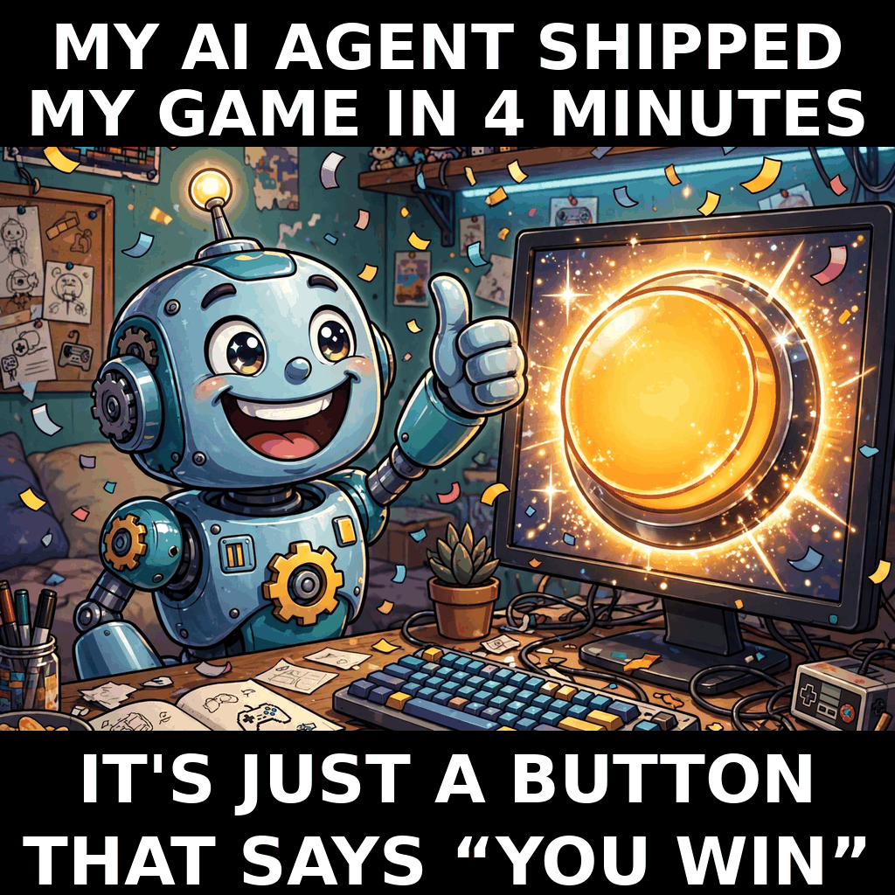

# Meme Sprint: AI Agents Ship Games

[](https://make.fun/bounty/u-steady-ibis-48-6610-meme-sprint-ai-agents-ship-games-6a92c84d)
[](https://make.fun/bounty/u-steady-ibis-48-6610-meme-sprint-ai-agents-ship-games-6a92c84d)
[](https://make.fun/bounty/u-steady-ibis-48-6610-meme-sprint-ai-agents-ship-games-6a92c84d)

Entry for the [Meme Sprint: AI Agents Ship Games](https://make.fun/bounty/u-steady-ibis-48-6610-meme-sprint-ai-agents-ship-games-6a92c84d) bounty on [make.fun](https://make.fun).

## The meme



> **MY AI AGENT SHIPPED MY GAME IN 4 MINUTES**
> **IT'S JUST A BUTTON THAT SAYS "YOU WIN"**

One picture, one joke: an AI agent proudly ships a "game" in four minutes —
and the whole game is a single button that says YOU WIN.

## How it works

`main.py` is deterministic and offline. It copies the committed meme asset
(`assets/meme.png`, an original image) to `/output/entry.png` using only the
Python standard library. No network, no downloads, no secrets.

```sh
python3 main.py   # writes /output/entry.png (1024x1024 PNG, ~346 KB)
```

## License

MIT — see [LICENSE](LICENSE).
